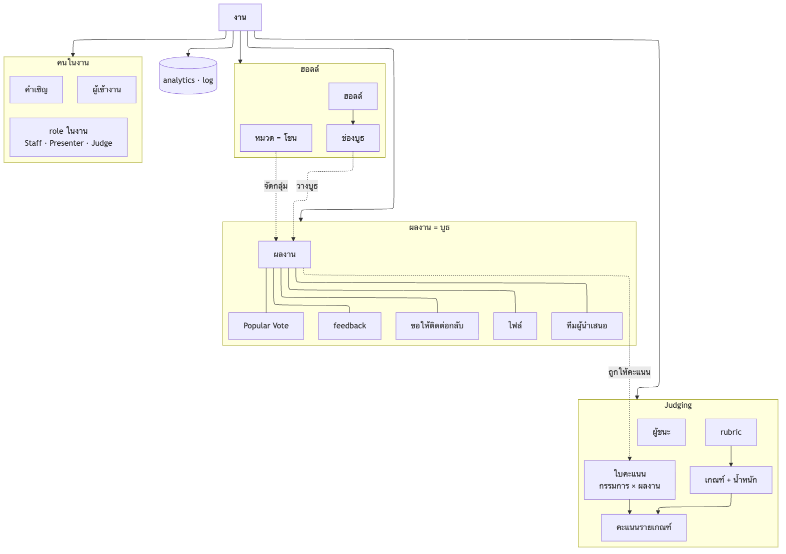
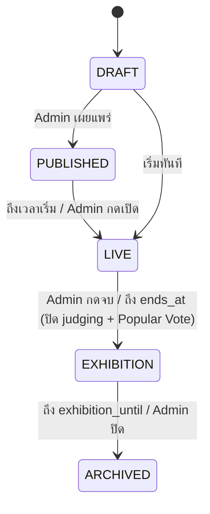

# Connecta — Data Model

> database design ทั้งหมด (PostgreSQL ตัวเดียวที่ทั้งแอปใช้): ภาพรวม · ตาราง · constraint · index · ข้อมูลที่ไม่เก็บ · state ใน memory · ไฟล์ · lifecycle · อิง `features.md` (ฟีเจอร์อ้างชื่อตารางจากไฟล์นี้) · stack อยู่ใน `technical.md`

---

## หลักการ

- **PostgreSQL ตัวเดียว** (+ pgvector) · เข้าถึงผ่าน Prisma · ชื่อในเอกสารเป็น `snake_case` (Prisma ใช้ `@map`/`@@map`)
- **id เป็น `uuid`** (`gen_random_uuid()`) ทุกตาราง ยกเว้นตาราง log ที่โตเร็วใช้ `bigserial`
- **ทุกอย่างผูกกับงาน** — ตารางในงานมี `event_id` เสมอ (ตรงๆ หรือผ่าน `project_id`) → เช็คสิทธิ์และลบงานได้ทีละงาน
- **role อยู่ระดับงาน** (`event_members.roles[]`) ไม่ใช่ที่ user · app role (`users.app_role`) เป็นอีกแกน
- **ตรวจกติกาที่ server** — constraint ที่ DB ทำได้ใส่ที่ DB (UNIQUE · CHECK · FK) · กติกาที่ข้ามตาราง (limit ของ plan · จำนวนกรรมการ) ตรวจใน service ภายใน transaction
- **ไม่เก็บของ ephemeral** — เสียง · วิดีโอ · proximity chat · public chat · reaction · ตำแหน่งดิบ (ดู [ไม่เก็บลง DB](#ไม่เก็บลง-db))
- **snapshot ข้อมูลที่ใช้ทำ analytics** — ประเภทผู้ใช้ + จังหวัดคัดลอกลง `event_attendees` ตอนเข้างาน แก้ profile ทีหลัง analytics งานเก่าไม่เปลี่ยน
- เวลาเป็น `timestamptz` ทุกช่อง

---

## ภาพรวม (Conceptual)

ฐานข้อมูลเดียว (PostgreSQL) ที่ทั้งแอปใช้ร่วมกัน: Next.js (Better Auth) · NestJS API · Colyseus (โหลดบูธ · เขียน analytics) · อ่านจากบนลงล่าง: **งาน → คนในงาน · ฮอลล์ → ผลงาน/บูธ → Judging**



- เส้นทึบ = เป็นของ (งานมีฮอลล์ · ผลงานมีไฟล์) · เส้นประ = อ้างถึง (ผลงานวางอยู่ที่ช่องบูธ · ใบคะแนนเป็นของผลงาน)
- **ผู้ใช้ (บัญชี)** ไม่ได้วาดเพื่อไม่ให้เส้นรก — ผู้ใช้เชื่อมกับ: role ในงาน · ผู้เข้างาน · ทีมผู้นำเสนอ · ใบคะแนน (ในฐานะกรรมการ) · feedback / vote / ขอให้ติดต่อกลับ (ในฐานะผู้ชม)
- แก้ภาพ: แก้ `images/data-model-concept.mmd` แล้ว render ใหม่ด้วย `npx @mermaid-js/mermaid-cli -i images/data-model-concept.mmd -o images/data-model-concept.png -w 1600 -b white`
- ER diagram แบบละเอียด (ทุกช่อง) generate จาก Prisma schema ตอนเริ่ม implement (เช่น `prisma-erd-generator`) จะได้ตรงกับของจริงเสมอ

| กล่องในภาพ | ตารางจริง |
|---|---|
| USER | `users` (+ `sessions` · `accounts` · `verifications` · `jwks` ของ Better Auth · `user_emails` · `notifications` · `subscriptions`) |
| EVENT | `events` (+ `event_interests` · `event_bans` · `event_forms` · `form_responses` · `reports` · `event_addons` · `audit_logs`) |
| EVENT_MEMBER · INVITE · ATTENDEE | `event_members` · `event_invites` · `event_attendees` |
| HALL · BOOTH_SLOT · CATEGORY | `halls` · `booth_slots` · `event_categories` |
| PROJECT · PROJECT_MEMBER · FILE | `projects` · `project_members` · `project_files` (+ `doc_chunks` สำหรับ AI) |
| RUBRIC · CRITERION · SCORE_SHEET · SCORE · AWARD | `rubrics` · `rubric_criteria` · `score_sheets` · `scores` · `awards` (+ `judge_assignments`) |
| FEEDBACK · VOTE · CONTACT_REQUEST | `feedbacks` · `votes` · `contact_requests` |
| ANALYTICS | `presence_sessions` · `booth_visits` · `heatmap_counts` · `analytics_events` |

---

## ตาราง

`PK` primary key · `FK` foreign key · `UK` unique · `?` nullable · ค่า enum อยู่ในหัวข้อ [Enum](#enum)

### 1. บัญชี (Better Auth + profile)

ตาราง `users` · `sessions` · `accounts` · `verifications` · `jwks` เป็นของ Better Auth (ชื่อและช่องตามเวอร์ชันที่ pin) · ช่อง profile เพิ่มผ่าน `additionalFields`

**`users`**
| ช่อง | ชนิด | หมายเหตุ |
|---|---|---|
| id | uuid PK | |
| email | text UK | อีเมลหลัก (จาก OAuth / magic link) |
| email_verified | bool | |
| name | text | จาก OAuth |
| display_name | text | onboarding · เติมจาก `name` |
| avatar_preset | text | preset เท่านั้น ไม่มี custom |
| visitor_type | `visitor_type` | analytics เท่านั้น ไม่แสดงให้ใครเห็น |
| province | text | analytics เท่านั้น (SDG) |
| organization | text? | แสดงให้คนในงานเห็น · ไม่บังคับ |
| position | text? | แสดงให้คนในงานเห็น · ไม่บังคับ |
| app_role | `app_role` | default `USER` |
| onboarded_at | timestamptz? | null = ยังไม่ onboarding → บังคับไปหน้า onboarding |
| deleted_at | timestamptz? | ลบบัญชี → ล้างข้อมูลส่วนตัว (ดู [Lifecycle](#lifecycle-และ-pdpa)) |
| created_at · updated_at | timestamptz | |

**`sessions`** — id · user_id FK · token UK · expires_at · ip_address · user_agent · ⚠️ ban แล้วลบ session ของคนนั้นในงานได้ทันที เพราะเก็บใน DB

**`accounts`** — id · user_id FK · provider_id (`microsoft` · `google`) · account_id · token ต่างๆ · UK (provider_id, account_id) · Google + Microsoft อีเมลเดียวกัน = user เดียว (account linking)

**`verifications`** — token ของ magic link (Better Auth จัดการ)

**`jwks`** — กุญแจของ JWT plugin · NestJS และ Colyseus ตรวจ JWT ผ่าน JWKS

**`user_emails`** — อีเมลอื่นที่ user พิสูจน์ได้ว่าเป็นเจ้าของ (รับคำเชิญด้วยบัญชีอื่น)
| ช่อง | ชนิด | หมายเหตุ |
|---|---|---|
| user_id | uuid FK | |
| email | text | UK (email) — 1 อีเมลผูกได้บัญชีเดียว |
| verified_at | timestamptz | เวลาที่กดลิงก์คำเชิญ |

**`notifications`** — id · user_id FK · kind text · payload jsonb · read_at? · created_at · index (user_id, read_at)

**`subscriptions`** (Billing C) — user_id FK UK · plan `plan` · status · current_period_end · stripe_customer_id? · stripe_subscription_id? · test mode เท่านั้น

### 2. งาน

**`events`**
| ช่อง | ชนิด | หมายเหตุ |
|---|---|---|
| id | uuid PK | |
| created_by | uuid FK users | คนสร้างงาน (ใช้หา plan ตอนสร้าง) · **ไม่ใช่ตัวกำหนดสิทธิ์** — สิทธิ์ Admin อยู่ใน `event_members` |
| slug | text UK | URL หน้างาน |
| title · description | text | |
| cover_key | text? | object key ใน MinIO |
| agenda | jsonb | `[{time, title}]` แสดงให้ผู้ชมรู้ · ไม่ล็อกอะไร |
| modules | jsonb | `{judging, popular_vote, feedback, model3d, ai}` → bool |
| status | `event_status` | `DRAFT → PUBLISHED → LIVE → EXHIBITION → ARCHIVED` |
| plan | `plan` | ตั้งตอนสร้าง (จาก subscription ของคนสร้างงาน) · อัปเกรดด้วย add-on |
| capacity | int | คนพร้อมกันที่ตั้งตอนสร้าง · CHECK ≤ limit ของ plan + add-on (ตรวจใน service) |
| starts_at | timestamptz | |
| ends_at | timestamptz | **บังคับ** · ค่าเริ่มต้น 23:59 ของวันเริ่ม · CHECK `ends_at > starts_at` |
| hall_open_mode | `hall_open_mode` | `SCHEDULE` เปิดตามเวลา · `MANUAL` Admin กดเปิด |
| exhibition_until | timestamptz? | ตั้งตอนจบงาน = จบงาน + 7 วัน (Free) / 30 วัน (Pro) + add-on |
| results_announced_at | timestamptz? | null = ยังไม่ประกาศ → ผู้นำเสนอ/ผู้ชมยังไม่เห็นผล |
| allowed_domain | text? | เช่น `kmutt.ac.th` · ใช้กับ Visitor เท่านั้น |
| booth_deadline | timestamptz? | เตือนเท่านั้น ไม่ล็อก |
| hall_preset | text | `room` · `hall` |
| suspended_at | timestamptz? | Platform Admin ระงับงาน |
| created_at · updated_at | timestamptz | |
- index: (status, starts_at) สำหรับหน้า Explore · created_by

**`event_categories`** — หมวดผลงาน (ไม่บังคับ · ไม่มีแถว = งานไม่มีหมวด)
| ช่อง | ชนิด | หมายเหตุ |
|---|---|---|
| id | uuid PK | |
| event_id | uuid FK | |
| name | text | UK (event_id, name) |
| color | text | สีโซน |
| sort | int | ลำดับวางโซน |

**`event_members`** — role ในงาน
| ช่อง | ชนิด | หมายเหตุ |
|---|---|---|
| event_id · user_id | uuid FK | PK (event_id, user_id) |
| roles | `event_role`[] | `ADMIN` · `PRESENTER` · `JUDGE` · **array** เพื่อ multi-role · ไม่มีแถว = Visitor |
| assigned_by | uuid FK users | |
| assigned_at | timestamptz | |
- index: GIN (roles) · (user_id) สำหรับหน้า Home
- กติกาใน service: assign role ได้เฉพาะ ADMIN · **ต้องเหลือ ADMIN ≥ 1 คนเสมอ** (ตรวจใน transaction) · กรรมการ ≤ 5 ในงาน Free

**`event_invites`**
| ช่อง | ชนิด | หมายเหตุ |
|---|---|---|
| id | uuid PK | |
| event_id | uuid FK | |
| email | text | lowercase |
| roles | `event_role`[] | |
| project_id | uuid FK? | คำเชิญ PRESENTER ของบูธไหน |
| token_hash | text UK | เก็บแค่ hash |
| status | `invite_status` | `PENDING` · `ACCEPTED` · `REVOKED` · `EXPIRED` |
| invited_by | uuid FK users | |
| accepted_by | uuid FK users? | บัญชีที่กดรับ (อาจคนละอีเมล) |
| expires_at | timestamptz | สร้าง + 14 วัน |
| created_at · accepted_at? | timestamptz | |
- resend = สร้างแถวใหม่ + ตั้งแถวเก่าเป็น `REVOKED`
- **ที่จองในฮอลล์** = จำนวนคนที่ได้รับเชิญ (`PENDING` + `ACCEPTED`) · ที่ของ Visitor = `capacity` − ที่จอง
- index: (event_id, status) · (email, status) สำหรับขึ้นคำเชิญในหน้า Home

**`event_addons`** (Billing C) — id · event_id FK · bought_by FK · extra_capacity int · extra_exhibition_days int · stripe_payment_id? · created_at

### 3. ฮอลล์ · ผลงาน · ไฟล์

**`halls`** — 1 งานมี 1 ฮอลล์
| ช่อง | ชนิด | หมายเหตุ |
|---|---|---|
| id | uuid PK | |
| event_id | uuid FK UK | |
| source | `hall_source` | `PRESET` · `CUSTOM` (map editor ภายหลัง) |
| map_json | jsonb | Tiled JSON (พื้น · ผนัง · ของตกแต่ง · layer `blocks` + `slots`) |

**`booth_slots`** — ช่องบูธ (แตกจาก layer `slots` ของแมปตอนสร้างฮอลล์)
| ช่อง | ชนิด | หมายเหตุ |
|---|---|---|
| id | uuid PK | |
| hall_id | uuid FK | |
| block | text | กลุ่มช่อง = หน่วยของโซน |
| fill_order | int | ลำดับเติม (block ใกล้ทางเข้าก่อน) · UK (hall_id, fill_order) |
| x · y · w · h | int | px |
| label | text | เลขบูธ |

**`projects`** — 1 ผลงาน = 1 บูธ
| ช่อง | ชนิด | หมายเหตุ |
|---|---|---|
| id | uuid PK | |
| event_id | uuid FK | |
| category_id | uuid FK? | null ได้เมื่องานไม่มีหมวด |
| booth_slot_id | uuid FK? UK | ช่องที่วาง · null = ยังไม่ได้วาง (ฮอลล์เต็ม) |
| title | text | |
| summary | text? | |
| tags | text[] | ใช้ค้นหา |
| cover_key | text? | |
| video_url | text? | YouTube / Vimeo เท่านั้น (ไม่โฮสต์เอง) |
| links | jsonb | `[{label, url}]` |
| ai_enabled | bool | ผู้นำเสนอเปิด AI ของบูธ (ต้องเปิด module ระดับงานด้วย) |
| created_at · updated_at | timestamptz | |
- index: (event_id, category_id) · GIN full-text บน title + summary + tags สำหรับค้นหา

**`project_members`** — project_id FK · user_id FK · PK (project_id, user_id) · คนที่เป็น PRESENTER ของบูธนั้น

**`project_files`**
| ช่อง | ชนิด | หมายเหตุ |
|---|---|---|
| id | uuid PK | |
| project_id | uuid FK | |
| kind | `file_kind` | `POSTER` · `SLIDES` · `DOC` (ให้ AI อ่าน) · `MODEL_3D` |
| object_key | text | MinIO |
| mime | text | **ตรวจจาก magic bytes ที่ server** ไม่เชื่อนามสกุล |
| size_bytes | bigint | CHECK ≤ limit ต่อชนิด |
| page_count | int? | โปสเตอร์/สไลด์ที่แปลงเป็นรูปแล้ว |
| use_for_ai | bool | |
| uploaded_by | uuid FK users | |
| created_at | timestamptz | |

**`doc_chunks`** — RAG
| ช่อง | ชนิด | หมายเหตุ |
|---|---|---|
| id | bigserial PK | |
| project_id | uuid FK | |
| file_id | uuid FK | ลบไฟล์ → ลบ chunk |
| content | text | |
| embedding | vector(n) | n ตาม embedding model ที่เลือก · index HNSW (cosine) |

### 4. เข้างาน · ในงาน

**`event_interests`** — event_id · user_id · created_at · PK (event_id, user_id) · ไม่ใช่การจองที่

**`event_attendees`** — มีแถว = มางานจริง (เข้าฮอลล์ครั้งแรก = กรอกฟอร์มเข้างาน)
| ช่อง | ชนิด | หมายเหตุ |
|---|---|---|
| event_id · user_id | uuid FK | PK |
| display_name | text | ชื่อที่ใช้ในงานนี้ |
| visitor_type | `visitor_type` | **snapshot** (เปลี่ยนสำหรับงานนี้ได้) |
| province | text | **snapshot** |
| consent_marketing | bool | รับอีเมลงานถัดไปของผู้จัด · default false |
| joined_at | timestamptz | |

**`event_bans`** — event_id · user_id · banned_by · reason · created_at · PK (event_id, user_id) · มีแถว = เข้างานนี้ไม่ได้ · ลบแถว = ยกเลิก ban

**`event_forms`** — id · event_id FK · kind `form_kind` (`JOIN` · `SURVEY`) · fields jsonb · UK (event_id, kind)
- `fields`: `[{id, type: short_text|single|multi|rating, label, options?, required, purpose}]` · `purpose` = "ใช้ทำอะไร" (PDPA)

**`form_responses`** — form_id FK · user_id FK · answers jsonb · created_at · PK (form_id, user_id)

**`feedbacks`**
| ช่อง | ชนิด | หมายเหตุ |
|---|---|---|
| id | uuid PK | |
| project_id | uuid FK | |
| author_id | uuid FK users | Admin เห็นเสมอ |
| text | text | |
| is_anonymous | bool | true = ผู้นำเสนอไม่เห็นชื่อ |
| status | `feedback_status` | `VISIBLE` · `HIDDEN` (ผู้นำเสนอซ่อน) · `REMOVED` (Admin ลบ) |
| created_at | timestamptz | |
- เห็นแค่ผู้นำเสนอของบูธ + Admin · ไม่มี API สาธารณะ

**`votes`** — event_id · user_id · project_id · created_at · **PK (event_id, user_id, project_id)** · ถอน = ลบแถว · ตรวจใน service: งานยังไม่จบ · แวะบูธแล้ว (`booth_visits`) ถ้าผู้จัดเปิดเงื่อนไขนี้

**`contact_requests`** — id · project_id FK · user_id FK · email · phone? · link? · message? · created_at · **UK (project_id, user_id)** · ถอน = ลบแถว · เห็นแค่ผู้นำเสนอของบูธนั้น

**`reports`**
| ช่อง | ชนิด | หมายเหตุ |
|---|---|---|
| id | uuid PK | |
| event_id | uuid FK | |
| reporter_id | uuid FK users | |
| target_user_id | uuid FK users | |
| target_kind | `report_target` | `USER` · `CHAT` · `FEEDBACK` |
| target_ref | text? | id ของ feedback |
| snapshot | text? | ข้อความ chat ตอนกด report (chat ไม่ได้เก็บลง DB จึงต้องคัดลอกไว้) |
| reason | text | |
| status | `report_status` | `OPEN` · `RESOLVED` · `DISMISSED` |
| handled_by | uuid FK? | |
| created_at | timestamptz | |

### 5. Judging

**`rubrics`** — id · event_id FK UK · locked_at? · 1 ชุดต่องาน · ล็อกเมื่อมีคะแนนแรก (ตั้ง `locked_at`)

**`rubric_criteria`**
| ช่อง | ชนิด | หมายเหตุ |
|---|---|---|
| id | uuid PK | |
| rubric_id | uuid FK | |
| name · description | text | แก้คำอธิบายได้หลังล็อก |
| max_score | int | CHECK > 0 · แก้ไม่ได้หลังล็อก |
| weight | numeric(5,2) | CHECK > 0 · แก้ไม่ได้หลังล็อก |
| sort | int | |

**`judge_assignments`** — event_id · judge_id · project_id · PK (judge_id, project_id) · ไม่มีแถวเลยในงาน = กรรมการทุกคนตัดสินทุกผลงาน

**`score_sheets`** — ใบคะแนน 1 ใบต่อกรรมการต่อผลงาน
| ช่อง | ชนิด | หมายเหตุ |
|---|---|---|
| id | uuid PK | |
| judge_id · project_id | uuid FK | **UK (judge_id, project_id)** |
| status | `sheet_status` | `DRAFT` · `SUBMITTED` |
| comment | text? | |
| comment_visible | bool | ผู้จัดซ่อนก่อนส่งให้ผู้นำเสนอได้ |
| submitted_at · updated_at | timestamptz | |
- **ตอนจบงาน**: DRAFT ที่ครบทุกเกณฑ์ → SUBMITTED อัตโนมัติ · ไม่ครบ = ไม่นับ

**`scores`** — sheet_id FK · criterion_id FK · score numeric · **PK (sheet_id, criterion_id)** · CHECK 0 ≤ score ≤ max_score (ตรวจใน service เพราะ max อยู่อีกตาราง)

**ผลรวม** (คำนวณ ไม่เก็บ): ต่อผลงาน = ค่าเฉลี่ยของใบที่ SUBMITTED · ต่อใบ = Σ(score / max_score × weight) / Σ weight

**`awards`** — event_id · project_id · kind `award_kind` (`JUDGES` · `AUDIENCE`) · rank int · PK (event_id, kind, rank) · สร้างตอน Admin กดประกาศผล: เลือกจำนวนอันดับที่จะแสดง (ค่าเริ่มต้น 3 · แยก judging กับ Audience award) ระบบเรียงตามคะแนน/โหวตให้ · หน้างานแสดงเฉพาะตารางนี้

### 6. Analytics · log

**`presence_sessions`** — id bigserial · event_id · user_id · joined_at · left_at? · ใช้นับคนพร้อมกัน · เวลาอยู่เฉลี่ย · กราฟคน online · ⚠️ ghost connection: server ปิด session ที่ไม่มี heartbeat

**`booth_visits`** — id bigserial · event_id · project_id · user_id · entered_at · left_at? · ใช้ทำคนแวะ · เวลาในบูธ · เงื่อนไข "แวะบูธก่อนโหวต" · index (project_id, user_id)

**`heatmap_counts`** — event_id · cell_x · cell_y · minute timestamptz · samples int · PK (event_id, cell_x, cell_y, minute)
- realtime server สุ่มตำแหน่งทุก ~5 วิ → นับใส่ช่อง 2×2 tile ใน memory → เขียนลง DB ทุก 1 นาที · **ไม่เก็บตำแหน่งดิบรายคน**
- "บูธที่คนเดินผ่านแต่ไม่แวะ" = ช่องหน้าบูธ (จาก `heatmap_counts`) เทียบกับ `booth_visits`

**`analytics_events`** — event อื่นทั้งหมด
| ช่อง | ชนิด | หมายเหตุ |
|---|---|---|
| id | bigserial PK | |
| event_id | uuid | |
| user_id | uuid? | |
| type | text | `interested` · `poster_view` · `screen_share_start` · `screen_share_end` · `search` · `ai_question` · `invite_sent` · `invite_accepted` · ... |
| project_id | uuid? | |
| data | jsonb | เช่น คำค้น · จำนวนผู้ชมจอแชร์ |
| created_at | timestamptz | |
- index: (event_id, type, created_at) · ถ้าโตมากค่อยแบ่ง partition ตามเดือน

**`audit_logs`** — id bigserial · event_id? (null = ระดับ platform) · actor_id · action text · target_id? · reason? · data jsonb · created_at · index (event_id, created_at)
- ทุกการใช้อำนาจ: assign/ถอด role · kick/ban · ลบ feedback · แก้บูธระหว่างงาน · ระงับงาน (Platform Admin)

---

## Enum

| enum | ค่า |
|---|---|
| `app_role` | `USER` · `PLATFORM_ADMIN` |
| `event_role` | `ADMIN` · `PRESENTER` · `JUDGE` (Visitor = ไม่มีแถวใน `event_members`) |
| `event_status` | `DRAFT` · `PUBLISHED` · `LIVE` · `EXHIBITION` · `ARCHIVED` |
| `hall_open_mode` | `SCHEDULE` · `MANUAL` |
| `plan` | `FREE` · `PRO` |
| `visitor_type` | `STUDENT` · `HIGH_SCHOOL` · `COMPANY` · `ALUMNI` · `PARENT` · `TEACHER` |
| `invite_status` | `PENDING` · `ACCEPTED` · `REVOKED` · `EXPIRED` |
| `hall_source` | `PRESET` · `CUSTOM` |
| `file_kind` | `POSTER` · `SLIDES` · `DOC` · `MODEL_3D` |
| `form_kind` | `JOIN` · `SURVEY` |
| `feedback_status` | `VISIBLE` · `HIDDEN` · `REMOVED` |
| `sheet_status` | `DRAFT` · `SUBMITTED` |
| `award_kind` | `JUDGES` · `AUDIENCE` |
| `report_target` | `USER` · `CHAT` · `FEEDBACK` |
| `report_status` | `OPEN` · `RESOLVED` · `DISMISSED` |

---

## สถานะของงาน



- จบงาน (เข้า EXHIBITION) ทำใน transaction เดียว: ปิด judging · DRAFT ที่ครบ → SUBMITTED · ตั้ง `exhibition_until`
- job ตรวจทุกนาที: งานที่ถึง `starts_at` (โหมด SCHEDULE) · `ends_at` · `exhibition_until`

---

## ไม่เก็บลง DB

| ข้อมูล | อยู่ที่ไหน | เหตุผล |
|---|---|---|
| เสียง · วิดีโอ · จอแชร์ | LiveKit (ส่งผ่านเท่านั้น) | ephemeral · ไม่อัด |
| ตำแหน่งผู้เล่นแบบละเอียด | Colyseus state | เก็บแค่ `heatmap_counts` ที่รวมแล้ว |
| proximity chat · public chat · reaction | Colyseus (memory ช่วงงาน) | ไม่ต้องแบก PDPA ของข้อความ · report คัดลอกข้อความลง `reports.snapshot` |
| สถานะบูธ (`● Live` · จำนวนคน) | Colyseus state | คำนวณจากตำแหน่ง |

## State ใน memory (Colyseus · 1 room ต่อ 1 ฮอลล์)

- `players`: sessionId → { userId, name, x, y, badges[] } · badge ออกจาก server จาก `event_members`
- `booths`: slotId → { projectId, title, zone, live, count } · โหลดจาก `projects` + `booth_slots` ตอนเปิด room · บูธเพิ่มระหว่างงาน → เขียน DB ก่อนแล้วค่อย patch state
- room ว่าง → ถูกทิ้ง (`autoDispose`) · เปิดใหม่โหลดจาก DB
- Redis: ยังไม่ใช้ใน MVP (วาง interface ไว้สำหรับหลาย process)

## ไฟล์ (MinIO)

```
events/{eventId}/cover.{ext}
events/{eventId}/projects/{projectId}/cover.{ext}
events/{eventId}/projects/{projectId}/files/{fileId}/original.{ext}
events/{eventId}/projects/{projectId}/files/{fileId}/pages/{n}.webp   ← โปสเตอร์/สไลด์ที่แปลงแล้ว
```
- bucket private · serve ผ่าน signed URL ที่หมดอายุ · ตรวจสิทธิ์ก่อนออก URL

## Lifecycle และ PDPA

- **ลบงาน** (Admin) → ลบทุกแถวที่มี `event_id` + โฟลเดอร์ `events/{eventId}/` ใน MinIO
- **ลบบัญชี** → ถ้ายังเป็น ADMIN คนเดียวของงานไหน ปฏิเสธพร้อมบอกชื่องาน · ผ่านแล้ว `users.deleted_at` · ล้าง name · email · organization · position · ลบ sessions/accounts · แถวที่อ้าง user ยังอยู่แต่แสดงเป็น "ผู้ใช้ที่ลบแล้ว" (คะแนน · feedback ของงานเก่าไม่หาย)
- **ถอน** vote / contact request = ลบแถวจริง
- `event_attendees.consent_marketing` = false → ผู้จัด export อีเมลคนนั้นไม่ได้
- analytics ดิบ (`analytics_events` · `presence_sessions` · `booth_visits` · `heatmap_counts`) เก็บจนกว่าจะลบงาน · ⚠️ ถามผู้จัด D-Day ตอนสัมภาษณ์ว่าต้องดูย้อนหลังนานแค่ไหน แล้วค่อยตั้งระยะเก็บ
