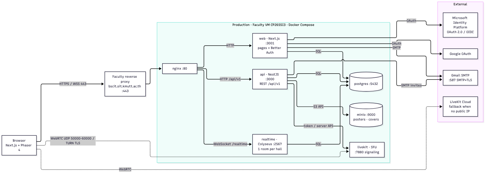
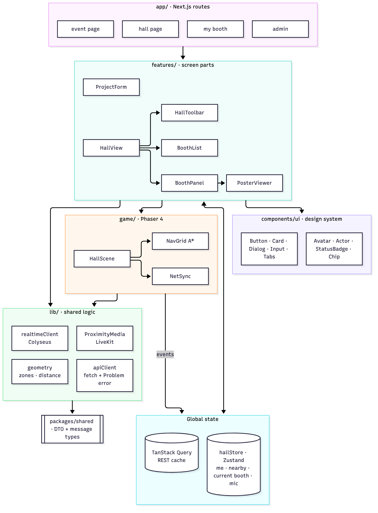
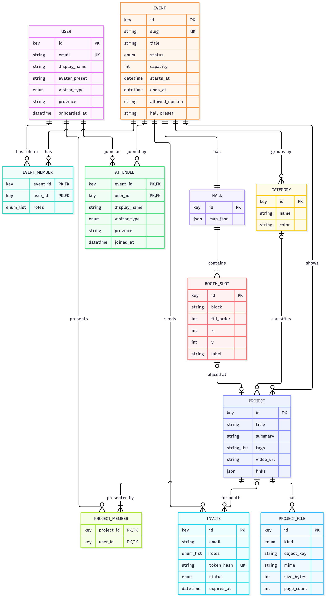

# Connecta — การออกแบบทางด้านเทคนิค (Release 1)

> ฉบับสำหรับ present Exam 2 หัวข้อ "การออกแบบทางด้านเทคนิค" (10 คะแนน) · ครอบคลุมแค่ Release 1 · เขียนให้ทุกคนในทีมอ่านแล้วพูดและตอบคำถามได้ · ฉบับเต็ม: `api.md` · `data-model.md` · `technical.md` · `features.md`

Exam 2 ให้คะแนนหัวข้อนี้จาก 5 ส่วน (Mockup · Architecture · Component Design · API Design · ER Diagram) และเน้น**กระบวนการออกแบบก่อนลงมือทำ** ยังไม่เน้นว่าออกแบบถูกทั้งหมด เอกสารนี้ไล่ตาม 5 ส่วนนั้น ก่อนหน้านั้นเป็นขอบเขตของ Release 1 และท้ายเอกสารมีตัวอย่างการไหลครบวงจร คำถามที่กรรมการน่าจะถาม และตำแหน่งไฟล์

## ขอบเขต Release 1 (Exam 3 · 30 พ.ย.)

กติกาวิชาบอกว่า Release 1 ต้องมี core feature อย่างน้อย 1 ตัวที่ทำงาน**ครบตั้งแต่หน้าเว็บ → backend → database** และต้อง deploy บน server จริง (ไม่ใช่ localhost) ส่วน login ไม่นับเป็น core feature

เราเลือกส่วนที่เป็น**ตัวตนของ Connecta** ก่อน คือ "เดินงานออนไลน์ได้ และคุยกับคนตรงหน้าได้" (core ⭐1–2 ใน `features.md`) เพราะเป็นสิ่งที่ Zoom/Teams ทำไม่ได้ และมี spike S1–S4 ที่ทดสอบผ่านแล้วรองรับอยู่

| ใคร | ทำได้ใน Release 1 |
|---|---|
| Admin | สร้างงาน (ชื่อ · เวลาเริ่ม-จบ · ฮอลล์ preset · จำนวนคนพร้อมกัน · หมวด) → เพิ่มผลงานพร้อมอีเมลสมาชิก → **บูธวางในฮอลล์ให้เองตามหมวด** → เชิญ Presenter → เผยแพร่ → เปิดฮอลล์ → จบงาน |
| Presenter | กดลิงก์คำเชิญ → แก้ข้อมูลบูธ (ชื่อ · สรุป · tag · ภาพปก · ลิงก์ · วิดีโอ) → อัปโหลดโปสเตอร์ PDF |
| Visitor | ดูหน้างานและรายการผลงาน → กรอกฟอร์มเข้างาน → เข้าฮอลล์ (ระบบเช็คว่ายังมีที่ว่าง และอีเมลอยู่ในโดเมนที่งานกำหนด) |
| ทุกคนในฮอลล์ | เดินด้วยการคลิกหรือปุ่มลูกศร · เห็นคนอื่นเดินแบบ realtime · กดรายการบูธแล้วตัวละครเดินไปเอง · เห็นป้าย `● Live` + จำนวนคนในบูธ · เปิดแผงบูธดูโปสเตอร์ · **คุยด้วยเสียงตามระยะ** (ไมค์ปิดตอนเข้า) · แชทกับคนใกล้ๆ (Nearby chat) |

| Release | ผู้ใช้ได้อะไร (value) | ฟีเจอร์ |
|---|---|---|
| **R1** (30 พ.ย.) | เดินงานออนไลน์ได้จริง คุยกับคนตรงหน้าได้ | ตามตารางด้านบน · login + onboarding (ไม่นับเป็น core) |
| R2 | คุยในบูธรู้เรื่อง · ตัดสินผลงานได้ · ดูแลงานได้ | เสียงโซนบูธ (S5) · แชร์จอ · โปสเตอร์ซูมตามกัน (S6) · mute/kick/ban + Admin panel · Judging · ค้นหาผลงาน · import CSV |
| R3 (D-Day ปลาย เม.ย.) | ผู้จัดและทีมได้ผลลัพธ์หลังงาน | Analytics · feedback · Popular Vote · ขอให้ติดต่อกลับ · Exhibition · survey · AI |

---

## 1. UX/UI Design: Mockup

ทีมเลือก **`poc/ui-mockup-v2`** เป็น theme หลัก (v1 เก็บไว้เทียบ) · เปิดด้วย `cd poc/ui-mockup-v2 && npm install && npm run dev` แล้วกดปุ่ม **All screens** มุมล่างซ้ายเพื่อไปทุกหน้า · ในหน้าฮอลล์สลับมุมมองได้ด้วยปุ่ม **Preview as** (Visitor / Presenter / Judge / Admin)

### Template / Style

- **สี**: พื้นสว่าง `#f6f7fb` · น้ำเงิน `#1d5cf5` สีหลัก (ปุ่ม · ลิงก์ · สิ่งที่กดได้) · navy `#0f1a3a` ตัวอักษร · ลาเวนเดอร์ `#e6dcfb` ป้าย role และ AI · ส้ม `#ff6a1a` จุดเน้น เช่น ป้าย Live · หมวดผลงานแต่ละหมวดมีสีโซนของตัวเอง ใช้ทั้งในเว็บและพื้นบูธในฮอลล์
- **ฟอนต์**: Plus Jakarta Sans (อังกฤษ) + Noto Sans Thai (ไทย) · UI เป็นภาษาอังกฤษ
- **ตัวละคร 2D pixel 14 แบบ**: เลือกตอน onboarding · ใช้เป็น avatar ทุกที่และเป็นตัวเราในฮอลล์ · ทำให้ดูเป็นมิตรกับนักศึกษา แต่หน้าเว็บด้านนอกยังเป็นเว็บทางการ
- **Workspace แบบเดียวกันทุก role**: Admin / Presenter / Judge ใช้ layout ที่มี sidebar เหมือนกัน เปลี่ยนแค่เมนู → คนที่มีหลาย role ไม่ต้องเรียนรู้หน้าตาใหม่
- **ไม่ใช้ UI framework**: สีและขนาดทั้งหมดเป็น CSS token ชุดเดียวใน `globals.css` → แก้ที่เดียวเปลี่ยนทั้งแอป

### หน้าใน Release 1

Landing `/` · Explore `/explore` · Login · Onboarding (เลือกตัวละคร) · My events `/home` · Profile · รับคำเชิญ `/invite/[token]` · หน้างาน `/e/[slug]` · ฟอร์มเข้างาน `/e/[slug]/join` (+ หน้าฮอลล์เต็ม) · **ฮอลล์** `/e/[slug]/hall` · แก้บูธ `/e/[slug]/my-booth` · สร้างงาน `/manage/new` · ผลงานและฮอลล์ `/manage/[slug]/projects`

### แนวคิดการออกแบบ: จาก pain สู่สิ่งที่เห็นบนจอ

| Pain / พฤติกรรมผู้ใช้ | ออกแบบ |
|---|---|
| ไม่กล้าเดินเข้าบูธ ไม่รู้ว่ามีทีมอยู่ไหม | ป้าย `● Live` ขึ้นเฉพาะตอนมี Presenter อยู่ในบูธ + จำนวนคน `👥 12` เห็นก่อนเดินเข้า |
| ผลงานเยอะ ไม่รู้จะดูอะไร | เข้าฮอลล์แล้วเห็นรายการบูธทั้งหมด กดแล้วตัวละครเดินไปเอง · พื้นบูธสีตามหมวด มีป้ายโซน |
| คนที่ไม่เล่นเกม / เกรงใจที่ต้องพูด | คลิกเพื่อเดิน · ไมค์ปิดตอนเข้า · Nearby chat สำหรับคนที่เปิดไมค์ไม่ได้ |
| งานวิชาการที่ดูเป็นเกมเกินไปคนไม่เข้า | หน้าเว็บด้านนอกเป็นเว็บปกติ · ตัวละครเป็นลูกเล่น ไม่ใช่ตัวหลัก |
| ผู้จัดไม่อยากสร้างแผนที่เอง | เลือก preset แล้วบูธวางจากรายการผลงานอัตโนมัติ · ช่องที่ไม่ใช้กลายเป็นต้นไม้และที่นั่ง ไม่เห็นโต๊ะเปล่า |

---

## 2. Infrastructure: Architecture

ระบบแบ่งเป็นหลาย service แต่ละตัวรันใน container ของตัวเอง (Docker Compose) บน VM ของคณะ · ภาพนี้ตอบคำถามของ Exam 2 ครบ: environment · host · container · port · protocol · ใครส่ง request หาใคร · ระบบภายนอก



เส้นทึบ = request ปกติ · เส้นประ = เสียง (WebRTC) ที่ browser ต่อตรงกับ LiveKit

### Environment

| Environment | Host | วิธีรัน |
|---|---|---|
| dev | เครื่องของแต่ละคน (localhost) | `docker compose` สำหรับ postgres · minio · livekit + `npm run dev` ของ web / api / realtime |
| production | VM คณะ `CP26SSI3` (4 vCPU · 8 GB · Ubuntu) · คนข้างนอกเข้าผ่าน reverse proxy ของคณะที่ `bscit.sit.kmutt.ac.th/capstone26/CP26SSI3` | Docker Compose ทุก service |

### แต่ละกล่องคืออะไร

| Container | Port · Protocol | หน้าที่ (อธิบายง่ายๆ) |
|---|---|---|
| **nginx** | 80 · HTTP + WebSocket | ประตูหน้าบ้าน รับทุก request แล้วส่งต่อตาม path: `/` ไปหน้าเว็บ · `/api/v1` ไป api · `/realtime` ไป game server |
| **web** (Next.js) | 3001 · HTTP | หน้าเว็บทั้งหมด + โลก 2D (Phaser) · เป็นที่อยู่ของระบบ login (Better Auth `/api/auth/*`) |
| **api** (NestJS) | 3000 · HTTP REST/JSON | สมองหลักของข้อมูล: สร้างงาน · แก้บูธ · คำเชิญ · อัปไฟล์ · ออก "บัตรเข้าฮอลล์" ให้คนที่ผ่านการตรวจสิทธิ์ |
| **realtime** (Colyseus) | 2567 · WebSocket | game server: 1 ห้องต่อ 1 ฮอลล์ · รู้ว่าใครยืนตรงไหน บูธไหนมีคนกี่คน · ส่ง Nearby chat |
| **livekit** | 7880 + UDP 50000–60000 · WebRTC | ตัวกลางส่งเสียง (SFU) · แต่ละคนส่งเสียงขึ้นไปครั้งเดียว แล้วเลือกฟังเฉพาะคนที่อยู่ใกล้ |
| **postgres** | 5432 · SQL | ฐานข้อมูลตัวเดียวของทั้งระบบ |
| **minio** | 9000 · S3 API | ที่เก็บไฟล์ (ภาพปก · โปสเตอร์) แยกจาก DB · ส่งให้ผู้ใช้ด้วยลิงก์ที่หมดอายุได้ (signed URL) |

### ระบบภายนอก (External Entity)

- **Microsoft Identity Platform + Google** — ให้ login (OAuth 2.0 / OIDC)
- **Gmail SMTP** — ส่งลิงก์ login (magic link) และอีเมลคำเชิญ
- **LiveKit Cloud** — แผนสำรองของเสียง

### เรื่องที่ต้องอธิบายได้

- **ทำไมเส้นเสียงไม่ผ่าน nginx** — เสียง realtime ส่งเป็น UDP ซึ่ง reverse proxy แบบ HTTP ส่งต่อให้ไม่ได้ browser จึงต้องต่อกับ LiveKit ตรง · ⚠️ ถ้าคณะให้ public IP และเปิดพอร์ตเสียงไม่ได้ เราสลับไปใช้ LiveKit Cloud โดยแก้แค่ URL กับ key ไม่ต้องแก้โค้ด
- **ระบบรู้ได้ยังไงว่าเราเป็นใคร** — ตอน login หน้าเว็บออก "บัตรประจำตัว" (JWT) ที่มีแค่ id ของเรา · api กับ game server ตรวจบัตรได้เองผ่าน JWKS โดยไม่ต้องรู้รหัสลับ · role ในงาน (Admin / Presenter / Judge) **ไม่ใส่ในบัตร** เพราะเปลี่ยนได้ระหว่างงาน → ทุก request ไปเช็คจาก DB ใหม่
- ผลทดสอบที่รองรับการออกแบบนี้ (S1–S4) อยู่ใน `poc/README.md`

---

## 3. Frontend: Component Design

หลักคือ**แยกตามหน้าที่** แต่ละชั้นรู้เรื่องเท่าที่จำเป็น ของที่ใช้ซ้ำได้ดึงออกมาไว้ที่เดียว → หน้าตาเหมือนกันทุกหน้า · แก้ที่เดียวเปลี่ยนทุกที่ · คนในทีมทำคนละส่วนได้โดยไม่ชนกัน



ลูกศร = ชั้นบนเรียกใช้ชั้นล่าง

| ชั้น | มีอะไร | เปรียบเทียบให้เห็นภาพ |
|---|---|---|
| `app/` routes | หน้าแต่ละหน้า เช่น หน้างาน หน้าฮอลล์ หน้าแก้บูธ | สารบัญ บอกว่าหน้านี้ประกอบด้วยชิ้นอะไร แทบไม่มี logic |
| `features/` | `HallView` · `BoothPanel` · `PosterViewer` · `BoothList` · `HallToolbar` · `ProjectForm` | ชิ้นส่วนของจอที่รู้เรื่องงานเรา · ใช้ซ้ำได้ เช่น `ProjectForm` ใช้ทั้งหน้าแก้บูธและปุ่ม Edit ในฮอลล์ |
| `components/ui` (Component Library) | `Btn` · `Pill` · `Icon` · `Status` / `LiveBadge` (`● Live`) · `RoleChip` · `Portrait` / `Actor` (ตัวละคร) · `Header` · `Workspace` (sidebar ตาม role) · `Kpis` · `Empty` | ตัวต่อเลโก้ ไม่รู้ว่าอยู่ในแอปอะไร · สีทั้งหมดมาจาก design token ชุดเดียว |
| `game/` | `HallScene` (Phaser 4 วาดโลก 2D) · `NavGrid` (หาทางเดิน A*) · `NetSync` (ทำให้คนอื่นเดินลื่น) | เวที · Phaser วาดอย่างเดียว ปุ่มและแผงทั้งหมดเป็น React วางทับข้างบน |
| `lib/` (JS Library) | `apiClient` (เรียก API + แปลง error เป็น `code`) · `realtimeClient` (Colyseus) · `ProximityMedia` (LiveKit เลือกฟังตามระยะ) · `geometry` (ระยะ · โซนบูธ) | เครื่องมือกลางที่ทุก feature ใช้ร่วม · ทดสอบแยกได้ |
| `packages/shared` | type ของข้อมูลที่ส่งไปมา (DTO + message) | สัญญาที่หน้าเว็บกับ server ใช้ร่วมกัน · ฝั่งไหนแก้ไม่ตรงจะ compile ไม่ผ่านทันที |

### State Management: ข้อมูลที่หลาย component ใช้ร่วมกันเก็บที่ไหน

- **`hallStore` (Zustand)** — สถานะในฮอลล์: ตัวเรา · คนที่เราได้ยิน · บูธที่ยืนอยู่ · ไมค์เปิดไหม · แผงที่เปิด · เมื่อ Phaser รู้ว่าเราเดินเข้าบูธ ก็ส่ง event (`enterBooth` · `leaveBooth` · `hearing`) เข้า store แล้ว `BoothPanel` กับ `HallToolbar` อ่านไปใช้ · เลือก Zustand เพราะแต่ละ component อ่านเฉพาะส่วนที่ใช้ (selector) ทั้งหน้าจึงไม่ re-render ทุกครั้งที่มีคนขยับ
- **TanStack Query** — เก็บข้อมูลที่ดึงจาก API (งาน · ผลงาน · บูธ) ไว้ใช้ซ้ำ · แก้บูธเสร็จแล้วทุกแผงเห็นข้อมูลใหม่โดยไม่ต้อง refresh
- **ตำแหน่งของคนอื่น** — อยู่ใน game server (Colyseus) ไม่อยู่ใน React

### หลักฐานที่ชี้ให้กรรมการดูได้

- mockup: `poc/ui-mockup-v2/src/components/` (`ui.tsx` · `actor.tsx` · `hall-game.tsx`) · design token: `poc/ui-mockup-v2/src/app/globals.css` · ฮอลล์ Phaser: `poc/ui-mockup-v2/src/game/HallScene.ts`
- POC: `poc/demo-app/web/src/game/` (`HallScene` · `PresetScene` · `nav.ts` · `NetSync.ts`) · `poc/demo-app/web/src/media/ProximityMedia.ts`

### แนวคิดการออกแบบ (ตามเกณฑ์)

| เกณฑ์ | ทำได้ยังไง |
|---|---|
| Design Consistency | design token ชุดเดียว + component library → ทุกหน้าสี ระยะ ปุ่ม เหมือนกัน |
| Maintenance | แยก game / UI / logic ออกจากกัน · แก้ Phaser ไม่กระทบหน้าเว็บ |
| Scalability | 1 room ต่อ 1 ฮอลล์ · เลือกฟังเสียงเฉพาะคนใกล้ → คนเพิ่มแล้วแต่ละเครื่องไม่หนักขึ้นตาม |
| Faster Future Development | ฟีเจอร์ใหม่ใช้ `apiClient` · component · type ใน `packages/shared` ที่มีอยู่แล้ว |

---

## 4. Backend: API Design

API คือ "เมนู" ที่ server เปิดให้หน้าเว็บสั่ง · เราออกแบบตามหลัก **REST** ซึ่งมีกฎไม่กี่ข้อ ถ้าทุกคนเขียนตามกฎเดียวกัน API ทั้งระบบจะเดาได้และอ่านง่าย

### กฎ 5 ข้อที่เราใช้

1. **URL คือ "ของ" ไม่ใช่ "การกระทำ"** — ใช้คำนามพหูพจน์ เช่น `/events` · `/projects` ไม่เขียน `/createEvent` · การกระทำใช้ method แทน: `GET` ดู · `POST` สร้าง · `PATCH` แก้บางส่วน · `PUT` แทนทั้งก้อน · `DELETE` ลบ
2. **ของที่เป็นของงานอยู่ใต้งาน** — `/events/{eventId}/projects` = ผลงานในงานนั้น · ซ้อนไม่เกิน 1 ชั้น · แก้ผลงานชิ้นเดียวใช้ `/projects/{projectId}` ตรงๆ
3. **เปลี่ยนสถานะด้วย PATCH** — เปิดฮอลล์ = `PATCH /events/{id}` ส่ง `{"status": "LIVE"}` แล้ว server ตรวจว่าเปลี่ยนจากสถานะเดิมได้ไหม (Draft → Live ได้ · Archived → Live ไม่ได้)
4. **การกระทำที่ "สร้างของใหม่" เป็น POST** — รับคำเชิญ = `POST /invites/{token}/acceptances` · ขอเข้าฮอลล์ = `POST /events/{id}/hall-tickets` ได้บัตรเข้าฮอลล์กลับมา
5. **ของที่มีได้ชิ้นเดียวต่อคนใช้ `/me`** — เช่น โหวต (R3) = `PUT /projects/{id}/votes/me` · กดซ้ำกี่ครั้งผลเหมือนเดิม (idempotent) → กันโหวตซ้ำได้ตั้งแต่ออกแบบ

รายละเอียดอื่น: ข้อมูลเป็น JSON ชื่อช่องแบบ `camelCase` · ส่งบัตรด้วย `Authorization: Bearer <JWT>` · อัปโหลดไฟล์เป็น `multipart/form-data` (server ตรวจเนื้อไฟล์จริง ไม่เชื่อนามสกุล)

### API ของ Release 1 (19 ตัว)

| Method | Path | ใครเรียก | ใช้ทำอะไร | Status / Error |
|---|---|---|---|---|
| GET · PATCH | `/me` | คนที่ login | ดู/แก้โปรไฟล์ และทำ onboarding | `200` · `400` |
| GET | `/me/events` · `/me/invites` | คนที่ login | หน้า My events · คำเชิญที่รออยู่ | `200` |
| GET | `/events` | ทุกคน | รายการงานในหน้า Explore | `200` |
| POST | `/events` | คนที่ login | สร้างงาน (Draft) + ฮอลล์จาก preset | `201` · `400` · `402 PLAN_LIMIT` |
| GET | `/events/{eventId}` | ทุกคน / Admin (ถ้า Draft) | ดูงาน | `200` · `404` |
| PATCH | `/events/{eventId}` | Admin | แก้งาน · เปลี่ยนสถานะ (เผยแพร่ · เปิดฮอลล์ · จบงาน) | `200` · `403` · `409 INVALID_STATUS_TRANSITION` |
| PUT | `/events/{eventId}/cover` | Admin | อัปโหลดภาพปกงาน | `200` · `413` · `415` |
| GET · POST | `/events/{eventId}/categories` | ทุกคน · Admin | หมวดผลงาน (= โซนในฮอลล์) | `200` · `201` · `409 ALREADY_EXISTS` |
| GET · POST | `/events/{eventId}/invites` | Admin | ดู/ส่งคำเชิญ | `200` · `202` · `409` เกินที่จอง |
| GET | `/invites/{token}` | คนที่ได้ลิงก์ | ดูคำเชิญ | `200` · `410 INVITE_EXPIRED` |
| POST | `/invites/{token}/acceptances` | คนที่ได้ลิงก์ | กดรับคำเชิญ | `201` · `410 INVITE_USED` |
| GET | `/events/{eventId}/projects` | ทุกคน | รายการผลงาน | `200` |
| POST | `/events/{eventId}/projects` | Admin | เพิ่มผลงาน · บูธวางให้เอง · ส่งคำเชิญสมาชิก | `201` · `409 HALL_NO_SLOT` |
| GET | `/projects/{projectId}` | ทุกคน | ดูข้อมูลบูธ | `200` · `404` |
| PATCH | `/projects/{projectId}` | Presenter ของบูธ · Admin | แก้บูธ | `200` · `403` · `412 STALE_VERSION` |
| POST | `/projects/{projectId}/files` | Presenter ของบูธ | อัปโหลดโปสเตอร์ | `202` · `413 FILE_TOO_LARGE` · `415 UNSUPPORTED_FILE` |
| GET | `/events/{eventId}/hall` | คนที่เข้างานแล้ว · Admin | แผนที่ฮอลล์ + บูธแต่ละช่อง | `200` · `403` |
| POST | `/events/{eventId}/attendances` | คนที่ login | ส่งฟอร์มเข้างาน | `201` · `403 DOMAIN_NOT_ALLOWED` · `409 ALREADY_EXISTS` |
| POST | `/events/{eventId}/hall-tickets` | คนที่เข้างานแล้ว | ขอเข้าฮอลล์ ได้บัตรสำหรับ game server + เสียง | `201` · `409 HALL_FULL` · `409 JOIN_FORM_REQUIRED` |

### ตอบ error ยังไง

ทุก error ตอบรูปแบบเดียวกันตามมาตรฐาน **RFC 9457 (Problem Details)** · มีช่อง `code` เป็นรหัสคงที่ → หน้าเว็บดู `code` แล้วเลือกข้อความเอง (เช่นแปลไทยได้) ไม่ต้องแกะข้อความภาษาอังกฤษ

ตัวอย่าง — ขอเข้าฮอลล์

```
POST /api/v1/events/9b1c…/hall-tickets
Authorization: Bearer eyJ…

201 Created
{ "realtimeUrl": "wss://…/realtime", "ticket": "…", "mediaUrl": "wss://…", "mediaToken": "…" }

409 Conflict   (Content-Type: application/problem+json · Retry-After: 30)
{ "type": "/errors/hall-full", "title": "Hall is full", "status": 409, "code": "HALL_FULL",
  "detail": "50 of 50 people are in the hall. Try again in a minute." }
```

### Status code ที่ใช้ จำง่ายๆ

| Status | ความหมาย | ตัวอย่างในระบบเรา |
|---|---|---|
| `200` · `201` · `202` · `204` | สำเร็จ · สร้างแล้ว · รับไปทำต่อ · สำเร็จแต่ไม่มีข้อมูลตอบ | สร้างงาน = 201 · อัปโหลดโปสเตอร์ = 202 (ต้องแปลง PDF เป็นภาพก่อน) |
| `400` | ข้อมูลที่ส่งมาผิดรูปแบบ | เวลาจบก่อนเวลาเริ่ม |
| `401` | ยังไม่ได้ login | บัตรหมดอายุ |
| `402` | เกินที่ plan ให้ | ตั้งคนพร้อมกันเกิน 50 ในงาน Free |
| `403` | login แล้วแต่ไม่มีสิทธิ์ | Presenter แก้บูธคนอื่น · อีเมลไม่อยู่ในโดเมนที่งานกำหนด |
| `404` | ไม่พบ | งานที่ยังเป็น Draft (คนนอกต้องไม่รู้ว่ามีงานนี้) |
| `409` | ขัดกับสถานะตอนนี้ | ฮอลล์เต็ม · ฮอลล์ไม่มีช่องว่างให้วางบูธ |
| `410` | ลิงก์/บัตรใช้ไม่ได้แล้ว | คำเชิญหมดอายุ หรือถูกใช้ไปแล้ว |
| `412` | มีคนแก้ก่อนเรา | สมาชิกทีม 2 คนแก้บูธพร้อมกัน |
| `413` · `415` | ไฟล์ใหญ่เกิน · ชนิดไฟล์จริงไม่ตรง | เปลี่ยนนามสกุล .exe เป็น .pdf |
| `429` · `500` · `503` | ถี่เกิน · server พัง · ระบบภายนอกล่ม | ส่งคำเชิญเกินโควตาต่อวัน · LiveKit ล่ม |

### Realtime (Colyseus)

นอกจาก REST ยังมี message ของ game server: `move {x, y, dir}` (เดิน) · `goToBooth {projectId}` (server เป็นคนย้ายตำแหน่ง กันโกงวาร์ป) · `chat:nearby {text}` · server แจ้ง `boothAdded` / `boothUpdated` เมื่อบูธเปลี่ยน

### กฎ "ห้ามเชื่อ client": ตรวจสิทธิ์ครบ 3 ทาง

1. REST API ทุกตัว · 2. message ทุกตัวใน game server · 3. ตอนออก token เสียง — เช่น ซ่อนปุ่มแชร์จออย่างเดียวไม่พอ server ต้องไม่ให้สิทธิ์แชร์จอกับคนที่ไม่ใช่ Presenter ด้วย

---

## 5. DB: Conceptual Design (ER Diagram)

มีภาพ 2 แบบ ใช้คนละที่:

| ภาพ | ใช้ทำอะไร | อยู่ที่ |
|---|---|---|
| **Conceptual** (ภาพด้านล่าง) | ภาพสำหรับสอบ · Exam 2 ขอ ER ที่**ไม่ผูกกับยี่ห้อ DB** · มี entity ที่ Release 1 ใช้ 11 ตัว · ชนิดข้อมูลแบบกลาง (string · int · datetime) | `images/r1-er.png` |
| **Physical** | ภาพสำหรับเขียนโค้ด · ทุกตาราง ทุกช่อง ชนิดข้อมูลของ PostgreSQL จริง (uuid · timestamptz · jsonb) แยก 6 หมวด แบบ MySQL Workbench | `images/db-*.svg` · ต้นฉบับ `db/connecta.dbml` |



### อ่านเส้นเชื่อมยังไง (crow's foot)

| ปลายเส้น | อ่านว่า | ตัวอย่างจากภาพ |
|---|---|---|
| `\|\|` ขีดสองขีด | มีหนึ่งเดียวแน่นอน | 1 งานมี 1 ฮอลล์ |
| `o\|` วงกลม + ขีด | มี 0 หรือ 1 | ช่องบูธ 1 ช่องวางผลงานได้ไม่เกิน 1 ชิ้น หรือว่าง |
| `\|{` ขีด + ตีนกา | มี 1 ขึ้นไป | ผลงานต้องมีสมาชิกอย่างน้อย 1 คน |
| `o{` วงกลม + ตีนกา | มี 0 ขึ้นไป | งานหนึ่งมีผลงานกี่ชิ้นก็ได้ รวมถึงยังไม่มีเลย |

### Entity แต่ละตัวคืออะไร

| Entity | คืออะไร |
|---|---|
| USER | บัญชีผู้ใช้ 1 คน ใช้ได้ทุกงาน |
| EVENT | งาน 1 งาน · สถานะ Draft → Published → Live → Exhibition → Archived |
| EVENT_MEMBER | **role ของคนในงานนั้น** (Admin / Presenter / Judge) เก็บเป็นรายการ · คนเดียวมีหลาย role ได้ |
| INVITE | คำเชิญทางอีเมล · เก็บแค่ hash ของ token · ใช้ได้ครั้งเดียว · หมดอายุ 14 วัน |
| ATTENDEE | คนที่มางานจริง (กรอกฟอร์มเข้างานแล้ว) · เก็บประเภทผู้ชม + จังหวัด ณ ตอนนั้นไว้ทำสถิติใน R3 |
| HALL · BOOTH_SLOT | แผนที่ฮอลล์ (มาจาก preset) และช่องบูธที่แตกออกมาจากแผนที่ |
| CATEGORY | หมวดผลงาน = โซนสีในฮอลล์ |
| PROJECT · PROJECT_MEMBER | ผลงาน 1 ชิ้น = บูธ 1 บูธ · สมาชิกทีมที่เป็น Presenter |
| PROJECT_FILE | ไฟล์ของบูธ เช่น โปสเตอร์ (ตัวไฟล์อยู่ใน minio · DB เก็บแค่ที่อยู่) |

### 3 การตัดสินใจที่ควรอธิบายได้

- **role อยู่ที่งาน ไม่ได้อยู่ที่ user** — อาจารย์คนเดียวเป็น Judge งานหนึ่ง และเป็น Visitor อีกงานได้ · คนที่ไม่มีแถวใน EVENT_MEMBER = Visitor
- **บูธ = ผลงานที่วางบนช่อง** — แผนที่มีช่องว่างเตรียมไว้ ระบบเอาผลงานไปลงช่องตามหมวด → เพิ่มผลงานระหว่างงานได้โดยไม่ต้องแก้แผนที่
- **ของบางอย่างไม่เก็บลง DB** — ตำแหน่งที่เดิน · เสียง · Nearby chat อยู่ใน game server / LiveKit ระหว่างงานเท่านั้น → ลดภาระด้าน PDPA และ DB ไม่ต้องเขียนทุกครั้งที่มีคนขยับ

ทั้งระบบ (R1–R3) มี 39 ตาราง รายละเอียดอยู่ใน `data-model.md`

---

## ตัวอย่างการไหลครบวงจร: ตั้งแต่สร้างงานจนคุยกันในฮอลล์

ใช้เล่าตอนเดโมได้ · ทุกขั้นคือ request จริงที่วิ่งผ่าน Frontend → Backend → DB ตามที่ Release 1 ต้องแสดง

1. **Admin สร้างงาน** `POST /events` → api สร้างแถวใน EVENT · HALL (จาก preset) · BOOTH_SLOT ทุกช่อง และตั้งให้คนสร้างเป็น Admin ใน EVENT_MEMBER
2. **เพิ่มผลงาน** `POST /events/{id}/projects` → สร้าง PROJECT · หาช่องว่างใน block ของหมวดนั้นแล้วตั้ง `booth_slot_id` · สร้าง INVITE ให้อีเมลสมาชิก
3. **เผยแพร่** `PATCH /events/{id} {"status":"PUBLISHED"}` → api ส่งอีเมลคำเชิญผ่าน Gmail SMTP
4. **Presenter รับคำเชิญ** `POST /invites/{token}/acceptances` → INVITE เป็น ACCEPTED · เพิ่ม role PRESENTER ใน EVENT_MEMBER + PROJECT_MEMBER
5. **Presenter อัปโหลดโปสเตอร์** `POST /projects/{id}/files` → ตรวจเนื้อไฟล์ว่าเป็น PDF จริง · เก็บใน minio · แปลงเป็นภาพ
6. **Admin เปิดฮอลล์** `PATCH /events/{id} {"status":"LIVE"}`
7. **ผู้ชมกรอกฟอร์มเข้างาน** `POST /events/{id}/attendances` → ตรวจโดเมนอีเมล · สร้าง ATTENDEE
8. **ผู้ชมขอเข้าฮอลล์** `POST /events/{id}/hall-tickets` → ตรวจ ban และที่ว่าง · ผ่านแล้วได้บัตร 2 ใบ: ใบหนึ่งต่อ game server อีกใบต่อเสียง
9. **เดินและคุย** — browser ต่อ Colyseus (ส่ง `move`) และ LiveKit (เสียง) ตรง · เข้าใกล้ใครภายใน 5 ช่องก็ได้ยินกัน · เดินเข้าบูธแล้วแผงบูธเปิดเอง

## เรื่องที่ทีมต้องตัดสินร่วมกัน

| เรื่อง | เลือกไว้ | ข้อควรรู้ |
|---|---|---|
| mute / kick / ban | R2 | `features.md` นับเป็น core ข้อ 1 ที่ "ห้ามตัด" · ย้ายมา R1 ได้แต่งานเยอะขึ้น |
| State management | Zustand + TanStack Query | ยังไม่อยู่ใน `technical.md` · ทีมโอเคแล้วค่อยเพิ่ม |
| Port ของ web | 3001 | api ใช้ 3000 อยู่แล้ว · ยังไม่ได้กำหนดใน `technical.md` |
| เสียงบน production | LiveKit บน VM ถ้าได้ public IP · ไม่งั้น LiveKit Cloud | ต้องถาม IT เรื่อง public IP และพอร์ต UDP ให้เร็วที่สุด |

## ถ้ากรรมการถาม

- **ทำไมแยกเป็นหลาย service ไม่ทำก้อนเดียว** — งานแต่ละแบบต่างกันมาก: REST ทำงานเป็นครั้งๆ · game server เปิด connection ค้างไว้และส่งตำแหน่ง 15 ครั้งต่อวินาที · เสียงต้องใช้ SFU เฉพาะทาง · แยกกันแล้ว game server ที่ทำงานหนักไม่ทำให้หน้าเว็บช้า และเปลี่ยนไปใช้ LiveKit Cloud ได้โดยไม่แตะส่วนอื่น
- **ทำไมไม่ต่อเสียงแบบ peer-to-peer** — ถ้ามี 10 คนใกล้กัน แต่ละคนต้องส่งเสียงออก 9 สาย เน็ตบ้านรับไม่ไหว · SFU ให้ส่งขึ้นไปสายเดียวแล้วเลือกฟังเฉพาะคนใกล้ · S4 ทดสอบแล้วสลับคนที่ได้ยินได้ใน 100–141 ms และไม่กะพริบที่ขอบระยะ
- **รองรับคนได้กี่คน** — S3 ทดสอบ 150 คนต่อฮอลล์ CPU ของ server ไม่เกิน 7% · เพดานที่ตั้งไว้ 300 คนต่อฮอลล์ เพราะ bandwidth ต่อคนเป็นตัวจำกัด
- **ป้องกันคนแอบอ้างเป็นกรรมการยังไง** — role ได้จากคำเชิญทางอีเมลเท่านั้น · server เช็ค role จาก DB ทุกครั้ง ไม่เชื่อสิ่งที่ browser ส่งมา · ป้ายบนตัวละครก็ออกจาก server
- **ทำไมใช้ PostgreSQL** — ข้อมูลส่วนใหญ่เป็นความสัมพันธ์ (งาน · คน · role · ผลงาน · คะแนน) และ R3 จะทำ AI ตอบคำถามจากเอกสารผลงาน ซึ่ง PostgreSQL มี pgvector เก็บ vector ได้ในฐานข้อมูลเดียวกัน

## ไฟล์อยู่ไหน แก้ยังไง

| ไฟล์ | ใช้ทำอะไร |
|---|---|
| `docs/exam2-technical-design.md` | ไฟล์นี้ · ฉบับ present Release 1 |
| `docs/api.md` | API ฉบับเต็มทุกฟีเจอร์ (R1–R3) |
| `docs/data-model.md` | คำอธิบายตาราง constraint index ทั้งหมด (ต้นฉบับของ DB) |
| `docs/db/connecta.dbml` | schema สำหรับวาดภาพ · แก้ตารางใน `data-model.md` แล้วต้องแก้ไฟล์นี้ให้ตรง · วางใน dbdiagram.io เพื่อจัดภาพ/export ได้ |
| `docs/images/db-*.svg` | ภาพ physical 6 หมวด · สร้างใหม่ด้วย `node docs/db/render.mjs` |
| `docs/images/r1-*.png` + `.mmd` | ภาพ architecture · component · ER ของ R1 · แก้ไฟล์ `.mmd` แล้ว render ด้วย `npx @mermaid-js/mermaid-cli -i X.mmd -o X.png -s 2 -b white` |
